<p align="center">
  
</p>

<h1 align="center">ProFolder</h1>

<p align="center">
  <strong>Your music production library, organized.</strong><br>
  Find every DAW project and every bounce on your drive, then track where each song stands.
</p>

<p align="center">
  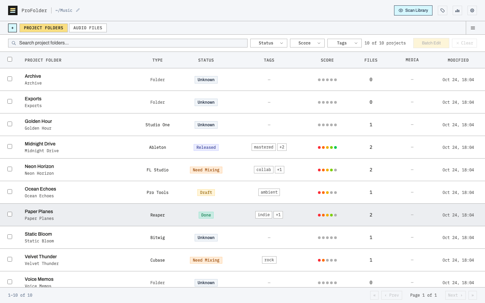
</p>

---

## Contents

- [What is ProFolder?](#what-is-profolder)
- [Installation](#installation)
  - [Desktop app](#desktop-app)
  - [Docker](#docker)
  - [From source](#from-source)
- [Getting started](#getting-started)
- [Features](#features)
  - [Your projects, found automatically](#your-projects-found-automatically)
  - [Every audio file in one list](#every-audio-file-in-one-list)
  - [Status, score, tags and notes](#status-score-tags-and-notes)
  - [Search, filter and sort](#search-filter-and-sort)
  - [Batch edit](#batch-edit)
  - [Built-in player](#built-in-player)
  - [Copy, move and delete](#copy-move-and-delete)
  - [Custom tabs](#custom-tabs)
  - [Your own statuses and tags](#your-own-statuses-and-tags)
  - [Library metrics](#library-metrics)
  - [Duplicate project detection](#duplicate-project-detection)
  - [Scanning you control](#scanning-you-control)
  - [Settings, safety and themes](#settings-safety-and-themes)
- [Privacy and safety](#privacy-and-safety)
- [Roadmap](#roadmap)
- [For developers](#for-developers)
- [License](#license)

---

## What is ProFolder?

A music production folder fills up fast: projects from different DAWs, a dozen bounces of the
same song, sample packs, backups and voice memos. ProFolder scans that folder and answers the
questions that matter to a producer:

- Which projects do I have, and which DAW made each one?
- Where are the bounces and exports of each song?
- Which tracks are drafts, which need mixing, and which are finished or released?
- Which ones are my best ideas?

It runs entirely on your computer. Nothing is uploaded anywhere, and scanning never changes
your files: ProFolder only reads your folder and keeps its own small database next to it.

ProFolder runs as a desktop app (macOS, with Windows and Linux builds), or in your browser
from Docker or the source code.

<video src="docs/screenshots/showcase.webm" controls muted width="900"></video>

[Watch the feature tour video](docs/screenshots/showcase.webm) if it doesn't play above.

## Installation

### Desktop app

Download the latest version from the
[Releases page](https://github.com/XavierXee/ProFolder/releases):

| Your computer | File to download |
|---|---|
| Mac with Apple Silicon (M1 or later) | `ProFolder-<version>-arm64.dmg` (smaller) |
| Any Mac (Intel or Apple Silicon) | `ProFolder-<version>-universal.dmg` |
| Windows (64-bit) | `ProFolder Setup <version>.exe` |
| Linux (64-bit) | `ProFolder-<version>.AppImage` or `profolder_<version>_amd64.deb` |

The builds aren't signed yet, so your system warns you the first time you open the app:

- **macOS:** open the `.dmg` and drag ProFolder to Applications. The first time you open it,
  macOS blocks it. Go to **System Settings → Privacy & Security** and click **Open Anyway**. If
  macOS says the app "is damaged", run `xattr -dr com.apple.quarantine /Applications/ProFolder.app`
  in Terminal, then open it again.
- **Windows:** if SmartScreen appears, click **More info → Run anyway**.
- **Linux:** make the AppImage executable (`chmod +x ProFolder-*.AppImage`) and run it, or
  install the `.deb` with `sudo apt install ./profolder_*_amd64.deb`.

ProFolder was built and tested on macOS. The Windows and Linux versions are new and haven't been
tested much yet.

### Docker

Run ProFolder in a container and use it from your browser. You need Docker and `make`:

```bash
git clone https://github.com/XavierXee/ProFolder.git && cd ProFolder
make up MUSIC_DIR="$HOME/Music"   # then open http://localhost:5175
```

`make down` stops it, and `make help` lists the other commands. A few actions need a desktop
(revealing a file in Finder, the folder picker and deleting to the Trash), so they don't work
inside the container.

### From source

You need [Node.js](https://nodejs.org) 24 or later:

```bash
git clone https://github.com/XavierXee/ProFolder.git && cd ProFolder
npm install
cp .env.example .env   # set MUSIC_ROOT if your music isn't in ~/Music
npm run dev            # then open http://localhost:5173
```

## Getting started

1. **Pick your production folder.** Click the folder path at the top of the window, then type a
   path or browse to one. By default ProFolder uses your Music folder.
2. **Scan it.** Press **Scan Library**, untick any folders you want to skip, and press **Scan**.
   A large library may take a minute the first time; later scans are quicker.
3. **Review and organize.** Browse **Project Folders** and **Audio Files**, open items to set a
   status, score and tags, and create custom tabs for the views you use most.
4. **Rescan whenever you've been working.** New bounces and projects show up, and everything you
   entered is kept.

## Features

### Your projects, found automatically

Point ProFolder at your production folder and press **Scan Library**. Every folder becomes a
row in **Project Folders**, and the app recognizes the DAW that made it: Ableton Live, Logic
Pro, FL Studio, Pro Tools, Cubase, Studio One, Reaper, Bitwig and Reason. Plain folders are
listed too, so nothing gets lost.

Each row shows the DAW, the status, the tags, a 1–5 score, how many audio files the project
contains and whether it holds video or images. Click a project to see what's inside its folder
and reveal it in Finder.

### Every audio file in one list

**Audio Files** gathers every bounce, mix, export and memo in one place: WAV, AIFF, MP3, M4A,
FLAC and OGG. Each file shows the project it belongs to and the folder it lives in, so a file
called `Final v3.wav` is never a mystery.

Sample packs and Ableton's backup folders are skipped by default, so the list holds your own
music rather than thousands of drum hits.

<p align="center">
  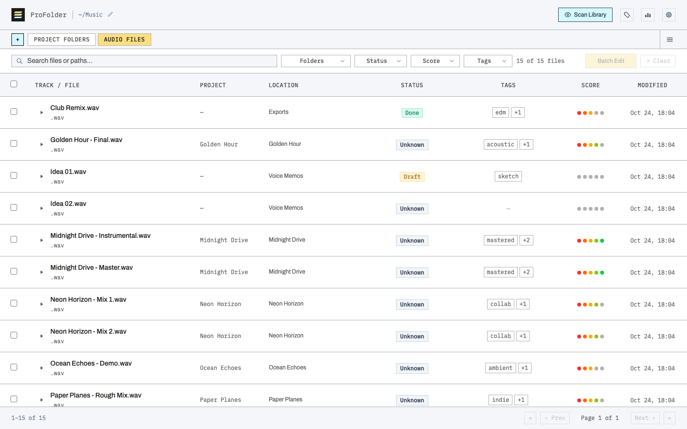
</p>

### Status, score, tags and notes

Open any project or file to describe it:

- **Status**: Unknown, Draft, Need Mixing, Done, Released, or your own.
- **Score**: 1 to 5 dots for how good it is. Click the same dot again to clear it.
- **Tags**: anything you like (`summer`, `collab`, `EP 2`). Existing tags are suggested as you type.
- **Notes**: free text, saved as you type.

Projects and their files stay in sync. Score or tag a project, and its audio files get the
same. Score a file, and its project's score becomes the best score among its files.

<p align="center">
  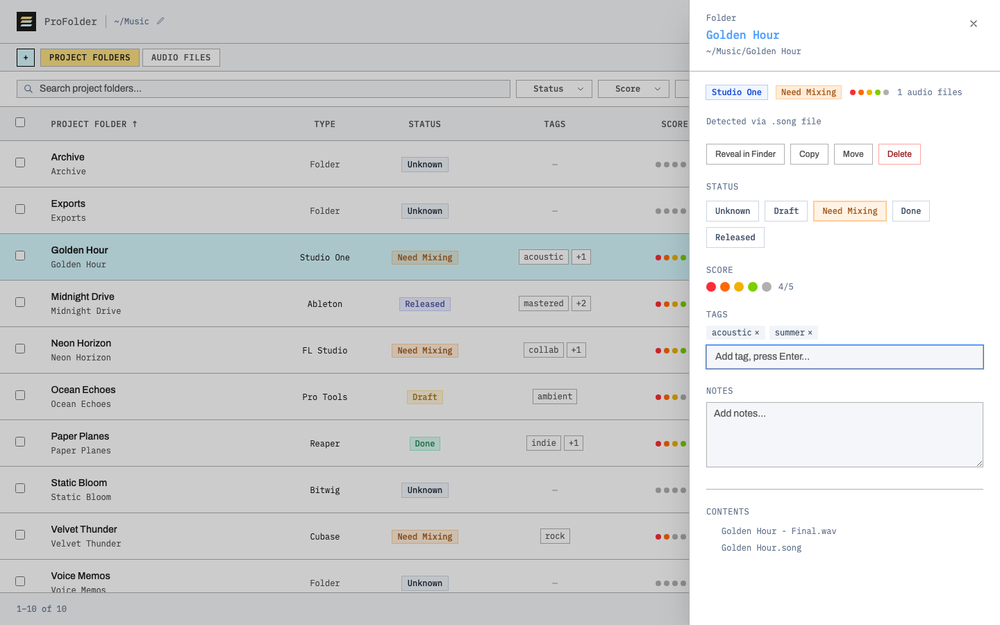
</p>

### Search, filter and sort

Type to search by name or path. Filter by one or more statuses, scores or tags, and combine
them. In Audio Files you can also show only the files that belong to a project, or only the
loose ones. Click any column header to sort, and click it again to reverse the order. **Clear**
resets everything in one click.

You can also browse with the keyboard: the arrow keys move between rows, Enter opens the
highlighted one, and Space plays or pauses an audio file.

### Batch edit

Tick several rows and press **Batch Edit** to give them all the same score, add a tag to all of
them, or copy, move or delete them together.

<p align="center">
  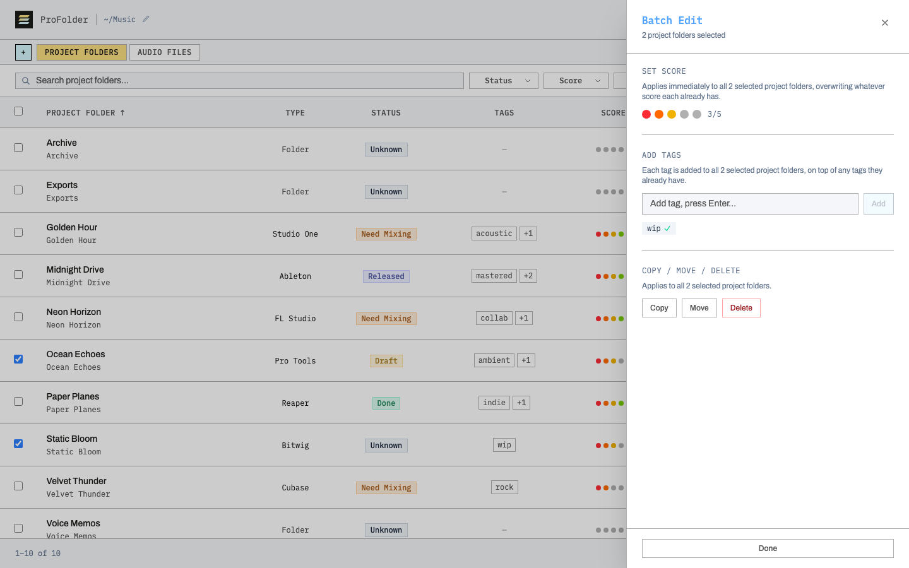
</p>

### Built-in player

Press the play button next to any audio file to listen right away. A player bar appears at the
bottom of the window, with seeking, stop and elapsed time. It keeps playing while you switch
tabs.

<p align="center">
  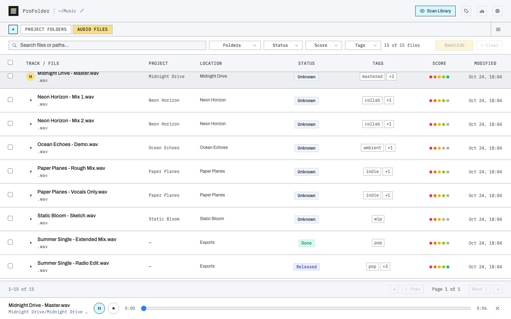
</p>

### Copy, move and delete

Reorganize your drive without leaving the app. Copy or move a file or a whole project folder to
another folder inside your library. Its status, score, tags and notes go with it.

- Delete moves items to the system Trash, so you can still get them back.
- To guard against slips, you type the word `COPY`, `MOVE` or `DELETE` to confirm. You can turn
  this off in Settings.
- Copying onto an existing name makes `Song copy.wav`, the way Finder does.
- Moving never overwrites anything.

<p align="center">
  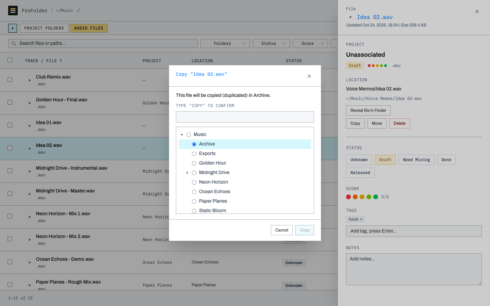
</p>

### Custom tabs

Save a view you use often as a tab of its own. For example, "Ready to Release" could show every
audio file whose status is Done. A custom tab can filter by status, score, tags and, for audio
files, whether they belong to a project. Search and sorting still work inside it.

Custom tabs are also a simple way to organize your discography. Give the tracks of an album or EP
a shared tag (for example `summer-ep`), then create a tab that filters on that tag: "Summer EP"
now lists every track of the release, wherever the files live on your drive.

Drag tabs to reorder them. When there are more tabs than fit, the tab bar scrolls, and the
**All tabs** button lists every tab so you can jump straight to one.

<table>
  <tr>
    <td width="50%">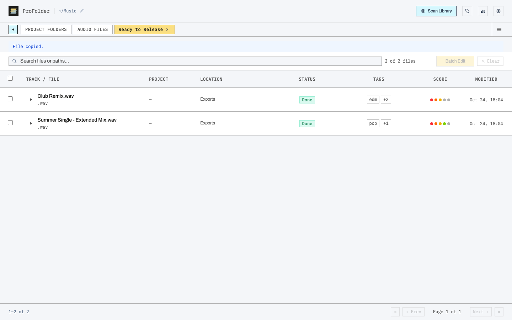</td>
    <td width="50%">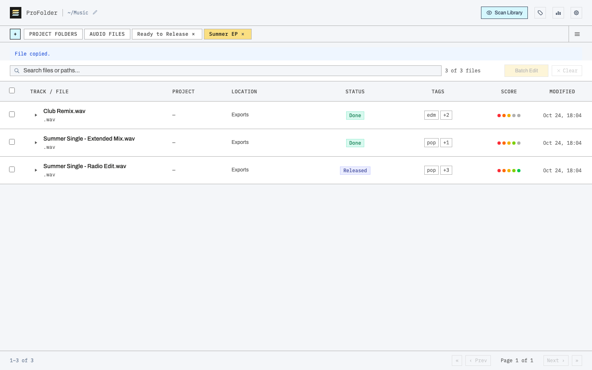</td>
  </tr>
  <tr>
    <td align="center">Ready to Release: every finished file</td>
    <td align="center">Summer EP: one release's tracks</td>
  </tr>
</table>

### Your own statuses and tags

ProFolder's statuses aren't fixed. Open **Statuses & tags** to add your own steps (for example
"Mastering"), rename them, give them a color, or delete them. You manage tags in the same place:
renaming a tag updates it everywhere, and deleting one removes it from every project and file.

<p align="center">
  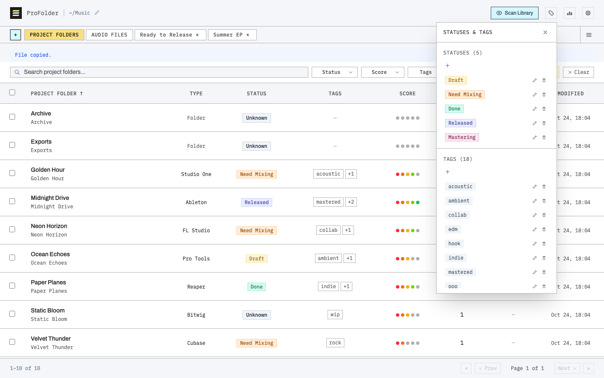
</p>

### Library metrics

**Metrics** gives an at-a-glance count of your projects and audio files: the total, how many
have each status, and how many carry a given tag. You choose which counts appear. It also shows
how many files changed in the latest scan.

<p align="center">
  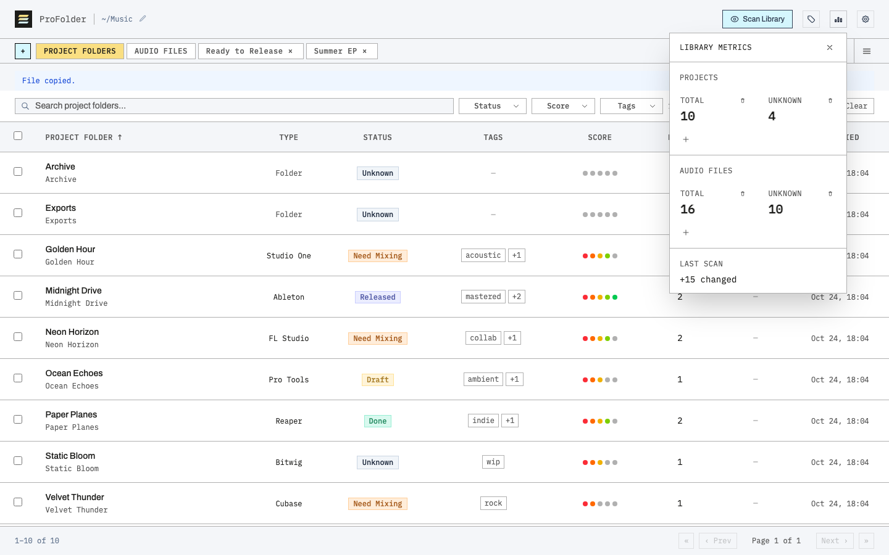
</p>

### Duplicate project detection

Copied a project to try something different and lost track of which one is which? When two
projects from the same DAW share most of their samples, the project's panel warns you and lists
the likely duplicates. You can adjust how strict this is in Settings.

### Scanning you control

**Scan Library** shows your folder tree. Untick the folders you don't want indexed, such as an
archive or a sample-pack drive, then scan. Rescanning picks up new, changed and deleted files,
and doesn't create duplicates. If a file disappears and later comes back, its status, score and
tags come back with it.

<p align="center">
  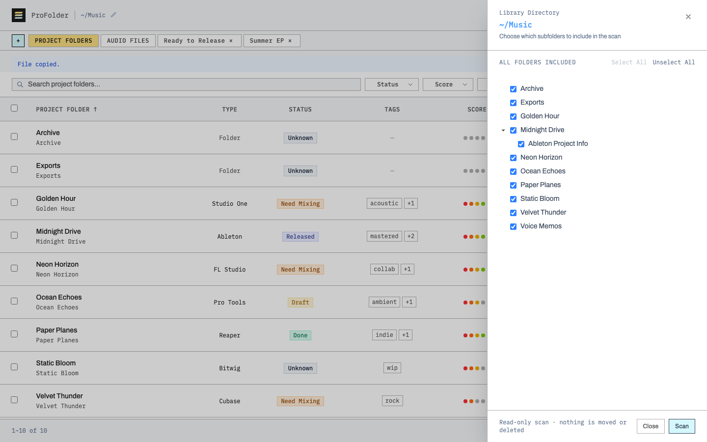
</p>

### Settings, safety and themes

**Settings** holds the rest:

- Skip Samples and Backup folders, or any folder whose name matches a pattern (such as stems).
- Choose how many rows each page shows.
- Turn off the typed confirmation (for example typing `DELETE`) that ProFolder asks for by
  default before deleting, moving or copying, and before removing a tab, status or tag.
- In the desktop app, choose where ProFolder keeps its database.
- Pick a theme: Default, Light or Dark.

<table>
  <tr>
    <td width="50%">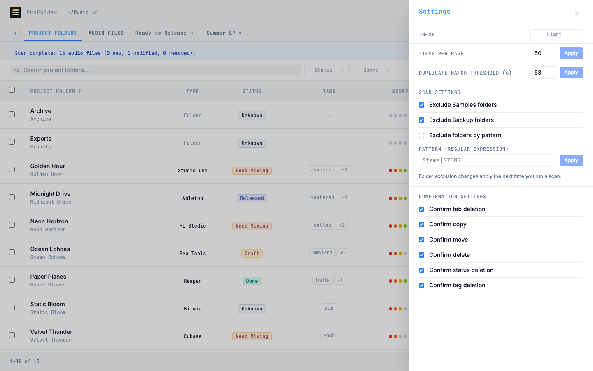</td>
    <td width="50%">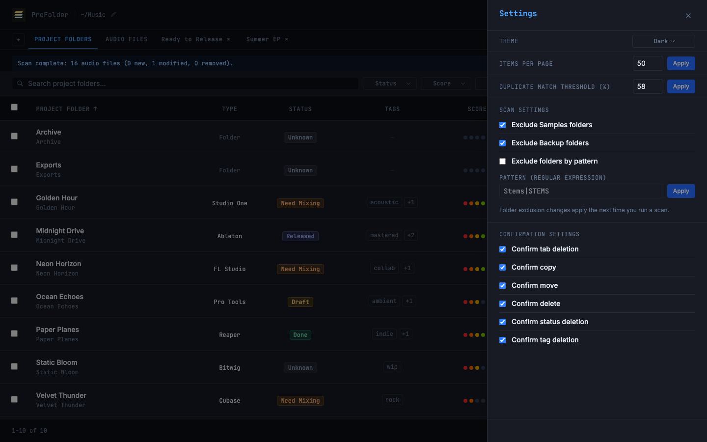</td>
  </tr>
  <tr>
    <td align="center">Light</td>
    <td align="center">Dark</td>
  </tr>
</table>

## Privacy and safety

- **Local only.** Your music and its details never leave your computer. ProFolder has no account,
  no telemetry and no analytics.
- **Read-only scanning.** A scan only looks at your files. Files change only when you ask for it
  with Copy, Move or Delete.
- **Reversible delete.** Delete sends items to the Trash rather than erasing them.
- **Private by default.** In browser mode, ProFolder only accepts connections from your own
  computer. It has no login, so it shouldn't be exposed to a network. The developer
  documentation explains the opt-in if you really want access from other devices.

## Roadmap

- Sync ProFolder tags with macOS Finder tags.
- Send finished tracks to the Music app, with playlists based on tags.
- Signed and notarized desktop builds.
- Add companion app for mobile devices.

## For developers

The technical documentation is in [`docs/`](docs):

- [`docs/REQUIREMENTS.md`](docs/REQUIREMENTS.md) describes how every feature behaves and covers
  the architecture, configuration, commands, desktop packaging and CI.
- [`docs/COVERAGE.md`](docs/COVERAGE.md) maps each requirement to the tests that cover it.

To regenerate the screenshots and the video in this README, run `npm run showcase`.

## License

[MIT](LICENSE)
